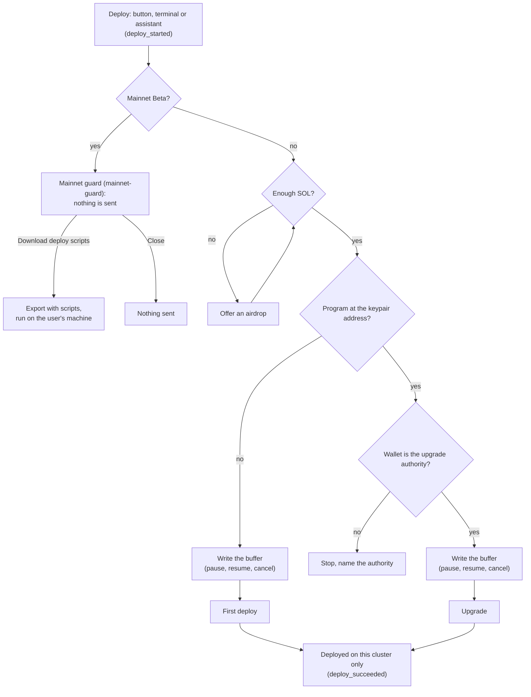

# Spec Delta

## Purpose

Puts a built program on one cluster at a time from the playground, and sends
every Mainnet Beta deploy to the user's own machine, so no real SOL is spent
through a key stored in the browser.

## ADDED Requirements

### Requirement: A deploy targets the selected cluster

A deploy SHALL upload the program binary to the cluster selected in the
connection settings and to no other. The selectable clusters SHALL be Playnet,
Localnet, Devnet, Testnet, Mainnet Beta and a custom RPC URL. A program on one
cluster SHALL NOT be shown as deployed on another.

#### Scenario: Devnet deploy is not on testnet

- **WHEN** the user deploys to Devnet and then selects Testnet
- **THEN** the Deploy stage shows the program as not deployed on Testnet

### Requirement: First deploy and upgrade

A deploy SHALL create the program at the program keypair's address when no
program exists there, and SHALL upgrade it when one exists and the paying
wallet is its upgrade authority. When the wallet is not the authority, the
deploy SHALL stop before any transaction and say which authority is required.

#### Scenario: Upgrade by a wallet that is not the authority

- **WHEN** the user deploys over a program whose upgrade authority is another
  key
- **THEN** no transaction is sent
- **AND** the playground names the upgrade authority the program requires

### Requirement: A deploy can be paused, resumed and cancelled

While the binary is written to the buffer, the user SHALL be able to pause,
resume and cancel the deploy. After a cancel, the playground SHALL offer to
close the buffer and return its rent to the paying wallet.

#### Scenario: Cancel and close the buffer

- **WHEN** the user cancels a deploy while the buffer is being written
- **AND** accepts closing the buffer
- **THEN** the buffer account is closed and its rent returns to the wallet

### Requirement: A low balance offers an airdrop

When the paying wallet holds less SOL than the deploy needs, the playground
SHALL say how much is missing and offer an airdrop of that amount.

#### Scenario: Short of SOL on devnet

- **WHEN** the wallet is short of SOL for a deploy on Devnet
- **THEN** the playground offers an airdrop of the missing amount

### Requirement: The playground never deploys to Mainnet Beta

The playground SHALL NOT send a deploy or an IDL upload transaction to Mainnet
Beta, for any wallet and however the deploy starts: the Deploy button, the
terminal `deploy` command or the assistant. A deploy started on Mainnet Beta
SHALL open the mainnet guard (`data-testid="mainnet-guard"`) instead, and
nothing is sent.

#### Scenario: Deploy on mainnet opens the guard

- **WHEN** the user clicks Deploy with Mainnet Beta selected
- **THEN** the mainnet guard dialog opens and no transaction is sent

#### Scenario: An extension wallet is blocked too

- **WHEN** the user deploys to Mainnet Beta with an extension wallet connected
- **THEN** the mainnet guard dialog opens and the extension is asked to sign
  nothing

#### Scenario: The assistant and the terminal are blocked

- **WHEN** the assistant or the terminal `deploy` command starts a deploy
  while Mainnet Beta is selected
- **THEN** the same mainnet guard dialog opens and no transaction is sent
- **AND** the terminal or the assistant says that a mainnet deploy runs from
  the user's machine with the deploy scripts

### Requirement: The terminal sends no program transaction to Mainnet Beta

The terminal SHALL NOT send a program deploy, an IDL write or a program
management transaction to Mainnet Beta. `solana program deploy` and `solana
program write-buffer` SHALL stay unavailable. `solana program close` and
`set-upgrade-authority`, and `anchor idl` `init`, `upgrade`, `write-buffer`,
`set-buffer`, `close`, `set-authority` and `erase-authority`, SHALL refuse on
Mainnet Beta, print that mainnet runs from the user's machine with the deploy
scripts, and send nothing.

#### Scenario: An Anchor IDL write on mainnet is refused

- **WHEN** the user runs `anchor idl init` with Mainnet Beta selected
- **THEN** the terminal refuses, names the deploy scripts, and no transaction
  is sent

#### Scenario: Solana program deploy is unavailable

- **WHEN** the user runs `solana program deploy` on any cluster
- **THEN** the terminal says the command is unavailable and no transaction is
  sent

### Requirement: The terminal checks the cluster a command resolves to

The terminal's Mainnet Beta check SHALL use the cluster each command
resolves to, including a `-u` or `--url` flag on the command, not only the
cluster selected in the settings.

#### Scenario: A URL flag cannot reach mainnet

- **WHEN** the user runs `solana -um program close <program id>` with Devnet
  selected
- **THEN** the terminal refuses and no transaction is sent

### Requirement: The mainnet guard sends the user to their own machine

The mainnet guard SHALL say that the playground does not deploy to Mainnet
Beta because real SOL would be spent through a key stored in this browser,
SHALL say that a mainnet deploy runs from the user's machine with the deploy
scripts, and SHALL offer Download deploy scripts
(`data-testid="mainnet-guard-scripts"`) and Close. It offers no way to deploy
from the playground.

#### Scenario: The guard offers only the scripts

- **WHEN** the mainnet guard dialog is open
- **THEN** it offers Download deploy scripts and Close, and no deploy action
- **AND** Close closes it with nothing sent

### Requirement: The export carries local deploy scripts

The project export SHALL contain a script that deploys the program binary
and a script that uploads the IDL to the Program Metadata program. Both
SHALL take the cluster and the payer keypair path as arguments, use the
user's installed Solana CLI and keep the program id of the playground's
program keypair. The export README SHALL say how to run them.

#### Scenario: Scripts in the export

- **WHEN** the user exports a built Anchor project
- **THEN** the zip holds the deploy script, the IDL upload script and the
  program keypair
- **AND** the README gives the commands to deploy to Mainnet Beta with them

#### Scenario: Scripts from the mainnet guard

- **WHEN** the user picks Download deploy scripts in the mainnet guard
- **THEN** the same export is downloaded and nothing is sent to the chain

### Requirement: The program keypair can be managed

The user SHALL be able to export the program keypair, import a keypair file to
replace it, and create a new one. Replacing a keypair of a deployed program
SHALL first say that the project will point at a new program id.

#### Scenario: Import a keypair

- **WHEN** the user imports a program keypair file
- **THEN** the next build declares that keypair's public key

### Requirement: Deploy telemetry

Deploy SHALL emit `deploy_started { cluster, kind }` whenever a deploy
starts, from the button, the terminal or the assistant, and before the
mainnet guard; `deploy_succeeded { cluster, kind }` when the program is live;
and `deploy_failed { cluster, kind, phase }` when it is not. `cluster`:
`playnet`, `localnet`, `devnet`, `testnet`, `mainnet`, `custom`; `kind`:
`first`, `upgrade`; `phase`: `buffer`, `write`, `deploy`, `authority`.

#### Scenario: A failed write is tracked

- **WHEN** a first deploy on Devnet fails while the buffer is written
- **THEN** the memory provider records `deploy_failed` with
  `{ cluster: "devnet", kind: "first", phase: "write" }`

### Requirement: Mainnet guard telemetry

The mainnet guard SHALL emit `deploy_mainnet_warned { choice }` when it
closes, `choice` being `scripts` or `close`. Download deploy scripts SHALL
also emit `deploy_scripts_exported` with no parameters.

#### Scenario: The guard choice is tracked

- **WHEN** the user closes the mainnet guard
- **THEN** the memory provider records `deploy_mainnet_warned` with
  `{ choice: "close" }`
- **AND** records neither `deploy_succeeded` nor `deploy_failed`

### Requirement: Every Deploy action emits an event

Every control on the Deploy screen that performs an action, a dialog choice
and Cancel included, SHALL emit its own event when used, separate from the
outcome events. A control without its event fails review. The requirements
that follow name each control's event.

#### Scenario: A deploy that stops at the guard

- **WHEN** the user clicks Deploy on Mainnet Beta and closes the guard
- **THEN** the memory provider records `deploy_started` then
  `deploy_mainnet_warned`, and no outcome event

### Requirement: Deploy progress controls are tracked

Pause, Resume and Cancel SHALL emit `deploy_paused`, `deploy_resumed` and
`deploy_cancelled { cluster }`, the first two with `{ cluster }` as well. The
close buffer question SHALL emit `deploy_buffer_close_answered { choice }`,
`choice` being `close` or `keep`. The stale binary warning SHALL emit
`deploy_stale_warned { choice }`, `choice` being `deploy` or `cancel`.

#### Scenario: Keep the buffer after a cancel

- **WHEN** the user cancels a deploy on Devnet and keeps the buffer
- **THEN** the memory provider records `deploy_cancelled` with
  `{ cluster: "devnet" }` and `deploy_buffer_close_answered` with
  `{ choice: "keep" }`

### Requirement: Deploy funding and program id controls are tracked

Airdrop SHALL emit `deploy_airdrop_requested { cluster }`. Copy program id
SHALL emit `deploy_program_id_copied` with no parameters.

#### Scenario: Airdrop on testnet

- **WHEN** the user accepts the airdrop offer on Testnet
- **THEN** the memory provider records `deploy_airdrop_requested` with
  `{ cluster: "testnet" }`

### Requirement: Program keypair controls are tracked

Export and New keypair SHALL emit `deploy_keypair_exported` and
`deploy_keypair_created`. Import SHALL emit `deploy_keypair_import_started`
on the click and `deploy_keypair_imported` once the keypair is replaced. The
warning before replacing a deployed program's keypair SHALL emit
`deploy_keypair_replace_warned { choice }`, `choice` being `replace` or
`cancel`. Unlisted parameters are none.

#### Scenario: Replacing a keypair is cancelled

- **WHEN** the user imports a keypair for a deployed program and cancels the
  warning
- **THEN** the memory provider records `deploy_keypair_import_started`, then
  `deploy_keypair_replace_warned` with `{ choice: "cancel" }`, and no
  `deploy_keypair_imported`
